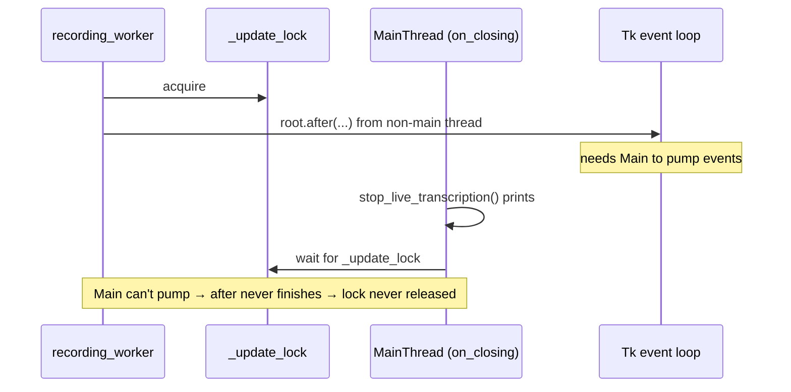

<!-- Generated by SpecStory, Markdown v2.1.0 -->

# 2026-07-16 14:12:44-0700

<!-- Cursor IDE Session d96162fb-bea5-4c1b-ac3d-5872096d33a2 (2026-07-16 14:12:44-0700) -->

_**User**_

debugger attach to running instance to figure out why it's hanging (Not Responding) on close

---

_**Agent (default)**_

<think><details><summary>Thought Process</summary>
Need to attach a debugger to the running process to diagnose the hang on close.

Checking the systematic-debugging skill and the logger app's shutdown code to identify the hang source.
</details></think>

_**Agent (default)**_

I'll look at how the app shuts down and outline how to attach a debugger to a hung instance.

_**Agent (default)**_

<tool-use data-tool-type="read" data-tool-name="read_file_v2"><details>
<summary>Tool use: **read_file_v2** • Read file: C:\Users\pho\.cursor\plugins\cache\cursor-public\superpowers\d884ae04edebef577e82ff7c4e143debd0bbec99\skills\systematic-debugging\SKILL.md</summary>

</details></tool-use>

_**Agent (default)**_

<tool-use data-tool-type="unknown" data-tool-name="ripgrep_raw_search"><details>
<summary>Tool use: **ripgrep_raw_search**</summary>

Parameters:

```json
{
  "caseInsensitive": false,
  "path": "C:\\Users\\pho\\repos\\EmotivEpoc\\ACTIVE_DEV\\PhoLogToLabStreamingLayer\\src\\phologtolabstreaminglayer\\logger_app.py",
  "pattern": "closeEvent|on_close|shutdown|quit|destroy|atexit|cleanup|Not Responding|WM_CLOSE|protocol\\("
}
```
Additional data:

```json
{
  "isPruned": true,
  "outputMode": "content",
  "path": "C:\\Users\\pho\\repos\\EmotivEpoc\\ACTIVE_DEV\\PhoLogToLabStreamingLayer\\src\\phologtolabstreaminglayer\\logger_app.py",
  "pattern": "closeEvent|on_close|shutdown|quit|destroy|atexit|cleanup|Not Responding|WM_CLOSE|protocol\\(",
  "topFiles": [
    {
      "matchCount": 23,
      "uri": "src\\phologtolabstreaminglayer\\logger_app.py"
    }
  ],
  "totalFiles": 1,
  "totalMatches": 23
}
```
Status: **completed**

</details></tool-use>

_**Agent (default)**_

<tool-use data-tool-type="unknown" data-tool-name="ripgrep_raw_search"><details>
<summary>Tool use: **ripgrep_raw_search**</summary>

Parameters:

```json
{
  "caseInsensitive": false,
  "path": "C:\\Users\\pho\\repos\\EmotivEpoc\\ACTIVE_DEV\\PhoLogToLabStreamingLayer",
  "pattern": "debugpy|pdb|breakpoint|listen\\(|wait_for_client"
}
```
Additional data:

```json
{
  "isPruned": true,
  "outputMode": "content",
  "path": "C:\\Users\\pho\\repos\\EmotivEpoc\\ACTIVE_DEV\\PhoLogToLabStreamingLayer",
  "pattern": "debugpy|pdb|breakpoint|listen\\(|wait_for_client",
  "topFiles": [
    {
      "matchCount": 4,
      "uri": "pixi.lock"
    },
    {
      "matchCount": 7,
      "uri": "uv.lock"
    }
  ],
  "totalFiles": 2,
  "totalMatches": 11
}
```
Status: **completed**

</details></tool-use>

_**Agent (default)**_

<think><details><summary>Thought Process</summary>
Found the shutdown path and confirmed debugpy is available.

Now examining the shutdown code and application launch configuration.
</details></think>

_**Agent (default)**_

<tool-use data-tool-type="read" data-tool-name="read_file_v2"><details>
<summary>Tool use: **read_file_v2** • Read file: C:\Users\pho\repos\EmotivEpoc\ACTIVE_DEV\PhoLogToLabStreamingLayer\src\phologtolabstreaminglayer\logger_app.py</summary>

</details></tool-use>

_**Agent (default)**_

<tool-use data-tool-type="read" data-tool-name="read_file_v2"><details>
<summary>Tool use: **read_file_v2** • Read file: C:\Users\pho\repos\EmotivEpoc\ACTIVE_DEV\PhoLogToLabStreamingLayer\src\phologtolabstreaminglayer\logger_app.py</summary>

</details></tool-use>

_**Agent (default)**_

<tool-use data-tool-type="read" data-tool-name="read_file_v2"><details>
<summary>Tool use: **read_file_v2** • Read file: C:\Users\pho\repos\EmotivEpoc\ACTIVE_DEV\PhoLogToLabStreamingLayer\src\phologtolabstreaminglayer\logger_app.py</summary>

</details></tool-use>

_**Agent (default)**_

<tool-use data-tool-type="search" data-tool-name="glob_file_search"><details>
<summary>Tool use: **glob_file_search** • Searched codebase "" • **0** results in **1** directory</summary>

Directory: **`C:\Users\pho\repos\EmotivEpoc\ACTIVE_DEV\PhoLogToLabStreamingLayer`** (0 files)
</details></tool-use>

_**Agent (default)**_

<tool-use data-tool-type="unknown" data-tool-name="ripgrep_raw_search"><details>
<summary>Tool use: **ripgrep_raw_search**</summary>

Parameters:

```json
{
  "caseInsensitive": false,
  "glob": "*.py",
  "path": "C:\\Users\\pho\\repos\\EmotivEpoc\\ACTIVE_DEV\\PhoLogToLabStreamingLayer\\src\\phologtolabstreaminglayer",
  "pattern": "join\\(|thread|Thread|pystray|mainloop|WM_DELETE|on_closing|quit_app|is_shutting_down"
}
```
Additional data:

```json
{
  "isPruned": true,
  "outputMode": "content",
  "path": "C:\\Users\\pho\\repos\\EmotivEpoc\\ACTIVE_DEV\\PhoLogToLabStreamingLayer\\src\\phologtolabstreaminglayer",
  "pattern": "join\\(|thread|Thread|pystray|mainloop|WM_DELETE|on_closing|quit_app|is_shutting_down",
  "topFiles": [
    {
      "matchCount": 5,
      "uri": "src/phologtolabstreaminglayer/console.py"
    },
    {
      "matchCount": 13,
      "uri": "src/phologtolabstreaminglayer/features/live_log_csv.py"
    },
    {
      "matchCount": 3,
      "uri": "src/phologtolabstreaminglayer/features/global_hotkey.py"
    },
    {
      "matchCount": 12,
      "uri": "src/phologtolabstreaminglayer/features/console_output_tk.py"
    },
    {
      "matchCount": 27,
      "uri": "src/phologtolabstreaminglayer/logger_app.py"
    }
  ],
  "totalFiles": 5,
  "totalMatches": 88
}
```
Status: **completed**

</details></tool-use>

_**Agent (default)**_

<think><details><summary>Thought Process</summary>
Investigating join timeouts, stop_recording, cleanup_GlobalHotkeyMixin, and the console entry point to find the hang cause.

Checking for a launch.json configuration to attach the debugger in Cursor or VS Code.
</details></think>

_**Agent (default)**_

<tool-use data-tool-type="read" data-tool-name="read_file_v2"><details>
<summary>Tool use: **read_file_v2** • Read file: C:\Users\pho\repos\EmotivEpoc\ACTIVE_DEV\PhoLogToLabStreamingLayer\src\phologtolabstreaminglayer\logger_app.py</summary>

</details></tool-use>

_**Agent (default)**_

<tool-use data-tool-type="unknown" data-tool-name="ripgrep_raw_search"><details>
<summary>Tool use: **ripgrep_raw_search**</summary>

Parameters:

```json
{
  "caseInsensitive": false,
  "path": "C:\\Users\\pho\\repos\\EmotivEpoc\\ACTIVE_DEV\\PhoLogToLabStreamingLayer\\src\\phologtolabstreaminglayer",
  "pattern": "\\.join\\(|cleanup_GlobalHotkey|stop_recording|stop_live_transcription|stop_taskbar|keyboard\\.|add_hotkey|GlobalHotkey"
}
```
Additional data:

```json
{
  "isPruned": true,
  "outputMode": "content",
  "path": "C:\\Users\\pho\\repos\\EmotivEpoc\\ACTIVE_DEV\\PhoLogToLabStreamingLayer\\src\\phologtolabstreaminglayer",
  "pattern": "\\.join\\(|cleanup_GlobalHotkey|stop_recording|stop_live_transcription|stop_taskbar|keyboard\\.|add_hotkey|GlobalHotkey",
  "topFiles": [
    {
      "matchCount": 26,
      "uri": "src/phologtolabstreaminglayer/logger_app.py"
    },
    {
      "matchCount": 5,
      "uri": "src/phologtolabstreaminglayer/features/global_hotkey.py"
    },
    {
      "matchCount": 2,
      "uri": "src/phologtolabstreaminglayer/features/recording_indicator_icon.py"
    },
    {
      "matchCount": 1,
      "uri": "src/phologtolabstreaminglayer/features/live_log_csv.py"
    }
  ],
  "totalFiles": 4,
  "totalMatches": 34
}
```
Status: **completed**

</details></tool-use>

_**Agent (default)**_

<tool-use data-tool-type="read" data-tool-name="read_file_v2"><details>
<summary>Tool use: **read_file_v2** • Read file: C:\Users\pho\repos\EmotivEpoc\ACTIVE_DEV\PhoLogToLabStreamingLayer\src\phologtolabstreaminglayer\console.py</summary>

</details></tool-use>

_**Agent (default)**_

<tool-use data-tool-type="unknown" data-tool-name="ripgrep_raw_search"><details>
<summary>Tool use: **ripgrep_raw_search**</summary>

Parameters:

```json
{
  "caseInsensitive": false,
  "path": "C:\\Users\\pho\\repos\\EmotivEpoc\\ACTIVE_DEV\\PhoLogToLabStreamingLayer\\src\\phologtolabstreaminglayer\\features\\global_hotkey.py",
  "pattern": "def cleanup|def stop_|join\\("
}
```
Additional data:

```json
{
  "isPruned": true,
  "outputMode": "content",
  "path": "C:\\Users\\pho\\repos\\EmotivEpoc\\ACTIVE_DEV\\PhoLogToLabStreamingLayer\\src\\phologtolabstreaminglayer\\features\\global_hotkey.py",
  "pattern": "def cleanup|def stop_|join\\(",
  "topFiles": [
    {
      "matchCount": 1,
      "uri": "src\\phologtolabstreaminglayer\\features\\global_hotkey.py"
    }
  ],
  "totalFiles": 1,
  "totalMatches": 1
}
```
Status: **completed**

</details></tool-use>

_**Agent (default)**_

<tool-use data-tool-type="read" data-tool-name="read_file_v2"><details>
<summary>Tool use: **read_file_v2** • Read file: C:\Users\pho\repos\EmotivEpoc\ACTIVE_DEV\PhoLogToLabStreamingLayer\pyproject.toml</summary>

</details></tool-use>

_**Agent (default)**_

<think><details><summary>Thought Process</summary>
Checking stop_live_transcription and keyboard cleanup. resolve_streams is a known hang point on LSL.

Pystray's Exit handler may call quit from a non-main thread. That would trigger Not Responding.
</details></think>

_**Agent (default)**_

<tool-use data-tool-type="read" data-tool-name="read_file_v2"><details>
<summary>Tool use: **read_file_v2** • Read file: C:\Users\pho\repos\EmotivEpoc\ACTIVE_DEV\PhoLogToLabStreamingLayer\src\phologtolabstreaminglayer\features\global_hotkey.py</summary>

</details></tool-use>

_**Agent (default)**_

<tool-use data-tool-type="unknown" data-tool-name="ripgrep_raw_search"><details>
<summary>Tool use: **ripgrep_raw_search**</summary>

Parameters:

```json
{
  "caseInsensitive": false,
  "path": "C:\\Users\\pho\\repos\\EmotivEpoc\\ACTIVE_DEV\\PhoLogToLabStreamingLayer\\src\\phologtolabstreaminglayer",
  "pattern": "def stop_live_transcription|def stop_recording|resolve_streams|wait_time"
}
```
Additional data:

```json
{
  "isPruned": true,
  "outputMode": "content",
  "path": "C:\\Users\\pho\\repos\\EmotivEpoc\\ACTIVE_DEV\\PhoLogToLabStreamingLayer\\src\\phologtolabstreaminglayer",
  "pattern": "def stop_live_transcription|def stop_recording|resolve_streams|wait_time",
  "topFiles": [
    {
      "matchCount": 5,
      "uri": "src/phologtolabstreaminglayer/logger_app.py"
    }
  ],
  "totalFiles": 1,
  "totalMatches": 5
}
```
Status: **completed**

</details></tool-use>

_**Agent (default)**_

<tool-use data-tool-type="read" data-tool-name="read_file_v2"><details>
<summary>Tool use: **read_file_v2** • Read file: C:\Users\pho\repos\EmotivEpoc\ACTIVE_DEV\PhoLogToLabStreamingLayer\src\phologtolabstreaminglayer\logger_app.py</summary>

</details></tool-use>

_**Agent (default)**_

<tool-use data-tool-type="unknown" data-tool-name="ripgrep_raw_search"><details>
<summary>Tool use: **ripgrep_raw_search**</summary>

Parameters:

```json
{
  "caseInsensitive": false,
  "path": "C:\\Users\\pho\\repos\\EmotivEpoc\\ACTIVE_DEV\\PhoLogToLabStreamingLayer\\src\\phologtolabstreaminglayer",
  "pattern": "def stop_live|whisper|transcription.*stop|join\\("
}
```
Additional data:

```json
{
  "isPruned": true,
  "outputMode": "content",
  "path": "C:\\Users\\pho\\repos\\EmotivEpoc\\ACTIVE_DEV\\PhoLogToLabStreamingLayer\\src\\phologtolabstreaminglayer",
  "pattern": "def stop_live|whisper|transcription.*stop|join\\(",
  "topFiles": [
    {
      "matchCount": 5,
      "uri": "src/phologtolabstreaminglayer/logger_app.py"
    },
    {
      "matchCount": 1,
      "uri": "src/phologtolabstreaminglayer/features/live_log_csv.py"
    },
    {
      "matchCount": 1,
      "uri": "src/phologtolabstreaminglayer/features/global_hotkey.py"
    }
  ],
  "totalFiles": 3,
  "totalMatches": 7
}
```
Status: **completed**

</details></tool-use>

_**Agent (default)**_

<think><details><summary>Thought Process</summary>
The user wants help attaching a debugger to a hung process to diagnose the hang on close.

The hang likely occurs because `on_closing()` blocks the main UI thread. Suspected culprits include `live_log_csv.stop()`, `stop_live_transcription()`, `stop_recording()`, and `stop_stream_discovery()`. The stream discovery worker may be stuck inside `pylsl.resolve_streams()`.

A critical bug candidate is the tray "Exit" path. It calls `quit_app` from the pystray daemon thread, which then runs `on_closing()` on that background thread instead of the Tk main thread. This can deadlock Tk and cause the "Not Responding" hang.

Other suspects include `cleanup_GlobalHotkeyMixin()`, `restore_streams()`, and `cleanup_lab_recorder()`.

To attach a debugger, use Cursor or VS Code to attach by process ID. Alternatively, launch the app with `debugpy.listen` and attach later.

For an already hung process, attach by PID and pause all threads to inspect their call stacks. faulthandler or py-spy can also reveal the hang without a full debugger.
</details></think>

_**Agent (default)**_

Using systematic debugging: treat the hang as a blocked main thread first, then attach and inspect stacks.

## What’s happening

Windows shows **Not Responding** when the **Tk main thread** stops pumping messages. Close goes through `WM_DELETE_WINDOW` → `on_closing()` on that thread:

```31:36:src/phologtolabstreaminglayer/console.py
    def on_closing():
        if app is not None:
            app.on_closing()
        else:
            root.destroy()
    root.protocol("WM_DELETE_WINDOW", on_closing)
```

`on_closing()` does a lot of synchronous work on the UI thread (stops, joins, hotkey cleanup, destroy):

```2390:2457:src/phologtolabstreaminglayer/logger_app.py
    def on_closing(self):
        self._shutting_down = True
        # live_log_csv.stop(), stop_live_transcription(), stop_recording(),
        # stop_stream_discovery() [join 2s], cleanup_GlobalHotkeyMixin(),
        # tray stop, cleanup_lab_recorder(), root.destroy()...
```

Likely blockers to check first when you pause:

| Spot | Why it can hang |
|------|-----------------|
| `keyboard.remove_hotkey` in `cleanup_GlobalHotkeyMixin` | Known Windows hangs |
| `pylsl.resolve_streams(...)` in discovery worker | Can stick; UI still waits on `join(2.0)` then continues |
| `stop_recording` / XDF save / lab-recorder stop | I/O or native wait |
| `stop_live_transcription()` | Model/audio teardown |
| Tray **Exit** → `quit_app()` | Runs `on_closing()` from the **pystray** thread, not Tk — classic deadlock / freeze |

---

## Attach to the already-running (hung) process

### Option A — Cursor / VS Code “Attach to Process” (best for a hung app)

1. Leave the hung window alone (don’t Task Manager kill it yet).
2. Note the PID (Task Manager → Details → `python.exe` / `logger_app`, or):
   ```powershell
   Get-Process python* | Select-Object Id, ProcessName, MainWindowTitle
   ```
3. In Cursor: **Run and Debug** → create/use a launch config like:

```json
{
  "version": "0.2.0",
  "configurations": [
    {
      "name": "Python: Attach by PID",
      "type": "debugpy",
      "request": "attach",
      "processId": "${command:pickProcess}",
      "justMyCode": false
    }
  ]
}
```

4. Start that config, pick the hung Python process.
5. Click **Pause** (or wait if it hits a breakpoint).
6. Open **Call Stack** and expand **every thread**. The smoking gun is usually:
   - Main/`MainThread` stuck inside `on_closing` / `stop_*` / `keyboard.*` / `resolve_streams` / `join`
   - Or a worker stuck while main is waiting on it

Set `"justMyCode": false` so you see frames inside `keyboard`, `pylsl`, `pystray`, etc.

### Option B — Pre-arm debugpy (better if you can reproduce)

Start the app so it listens for a debugger, then close to hang:

```powershell
# from repo root, using your usual env
python -m debugpy --listen 5678 --wait-for-client -m phologtolabstreaminglayer.console
# or without waiting:
python -m debugpy --listen 5678 -m phologtolabstreaminglayer.console
```

Attach config:

```json
{
  "name": "Python: Attach localhost",
  "type": "debugpy",
  "request": "attach",
  "connect": { "host": "localhost", "port": 5678 },
  "justMyCode": false
}
```

Breakpoints in `LoggerApp.on_closing`, `stop_recording`, `stop_stream_discovery`, `cleanup_GlobalHotkeyMixin`, `live_log_csv.stop`, `root.destroy`.

Step through close: whichever line never returns is the root cause.

### Option C — No IDE: dump stacks with `py-spy` / `faulthandler`

If attach fails (frozen native code, wrong interpreter):

```powershell
# install once if needed: pip/uv add py-spy
py-spy dump --pid <PID>
# or continuous:
py-spy top --pid <PID>
```

That prints every thread’s Python stack without cooperating with debugpy.

Or before next run, force periodic dumps:

```python
import faulthandler, signal
faulthandler.enable()
# Windows: faulthandler.dump_traceback_later(5, repeat=True)
```

---

## How to read the stacks

1. Find the thread running `tkinter` / `mainloop` / `on_closing`.
2. Note the **deepest non-stdlib frame** (your code or `keyboard` / `pylsl` / whisper).
3. Check other threads: discovery stuck in `resolve_streams`, tray in `pystray`, recording join, etc.
4. Note whether you closed via **window X** (Tk thread) or **tray Exit** (pystray thread calling `quit_app` → `on_closing`).

---

## Practical sequence

1. Reproduce hang once with console visible so prints from `on_closing` show how far it got (“Stream discovery stopped”, “Global hotkey cleaned up…”, etc.).
2. Attach by PID → Pause → dump all call stacks.
3. If stacks are unhelpful, next run with debugpy + breakpoints at the start of each step in `on_closing`.

I'm in **Ask mode**, so I can’t add a launch config or instrumentation for you. Switch to Agent mode if you want that wired up, or paste a `py-spy dump` / Call Stack and we can pinpoint the blocker.

---

_**User**_

@c:\Users\pho\.cursor\projects\c-Users-pho-repos-EmotivEpoc-ACTIVE-DEV-PhoLogToLabStreamingLayer\terminals\1.txt:825-836 @c:\Users\pho\.cursor\projects\c-Users-pho-repos-EmotivEpoc-ACTIVE-DEV-PhoLogToLabStreamingLayer\terminals\1.txt:899-1053 

---

_**Agent (default)**_

<think><details><summary>Thought Process</summary>
The user shared py-spy dump results and wants me to analyze them.

The dump shows the MainThread deadlocked inside `stop_live_transcription` during `on_closing`. The stack trace reveals `_on_text_written` calling `write` while the GUI mainloop is blocked.

A second thread is also blocked. Thread-7 (recording_worker) is stuck inside `after` while calling `write` during `stop_recording`. Both threads are deadlocked on stdout capture.

The recording worker is invoking `root.after()` from a background thread, which violates Tk’s thread affinity. A third idle thread is also blocked inside `_on_text_written` via `write`. This confirms the deadlock stems from stdout capture (`TkTextStream`) colliding with Tk’s single-threaded GUI model.
</details></think>

_**Agent (default)**_

The dump shows a clear deadlock pattern — I'll inspect the console capture path those stacks point at.

_**Agent (default)**_

<tool-use data-tool-type="read" data-tool-name="read_file_v2"><details>
<summary>Tool use: **read_file_v2** • Read file: C:\Users\pho\repos\EmotivEpoc\ACTIVE_DEV\PhoLogToLabStreamingLayer\src\phologtolabstreaminglayer\features\console_output_tk.py</summary>

</details></tool-use>

_**Agent (default)**_

<tool-use data-tool-type="read" data-tool-name="read_file_v2"><details>
<summary>Tool use: **read_file_v2** • Read file: C:\Users\pho\repos\EmotivEpoc\ACTIVE_DEV\PhoLogToLabStreamingLayer\src\phologtolabstreaminglayer\features\console_output_tk.py</summary>

</details></tool-use>

_**Agent (default)**_

<tool-use data-tool-type="search" data-tool-name="glob_file_search"><details>
<summary>Tool use: **glob_file_search** • Searched codebase "" • **0** results in **1** directory</summary>

Directory: **``** (0 files)
</details></tool-use>

_**Agent (default)**_

<tool-use data-tool-type="read" data-tool-name="read_file_v2"><details>
<summary>Tool use: **read_file_v2** • Read file: C:\Users\pho\repos\EmotivEpoc\ACTIVE_DEV\PhoLogToLabStreamingLayer\src\phologtolabstreaminglayer\logger_app.py</summary>

</details></tool-use>

_**Agent (default)**_

<think><details><summary>Thought Process</summary>
The classic Tk deadlock is now clear.

MainThread holds `_update_lock` inside `_on_text_written` while waiting for `after()` to return. The recording worker holds the same lock during `_register`. This cross-thread lock contention deadlocks the GUI thread.

The recording worker is blocked inside `root.after()` from a background thread. Tk's `after()` must post to the main thread, but MainThread is stuck waiting for the lock that the worker currently holds. This circular dependency deadlocks the GUI thread.

The watch thread is also stuck waiting for the lock. The GUI thread is frozen because `on_closing` never reaches `stop_recording`, so the acquisition loops keep running. The recording worker is trapped inside `root.after()`, and MainThread is stuck waiting for the lock that the worker holds.

LoggerApp and ConsoleOutputFrame maintain separate `_shutting_down` flags. LoggerApp sets its own flag, but the console frame likely only sets its own later during `restore_streams`. This mismatch could prevent the console frame from recognizing the shutdown state.
</details></think>

_**Agent (default)**_

<tool-use data-tool-type="unknown" data-tool-name="ripgrep_raw_search"><details>
<summary>Tool use: **ripgrep_raw_search**</summary>

Parameters:

```json
{
  "caseInsensitive": false,
  "path": "C:\\Users\\pho\\repos\\EmotivEpoc\\ACTIVE_DEV\\PhoLogToLabStreamingLayer\\src\\phologtolabstreaminglayer\\features\\console_output_tk.py",
  "pattern": "_shutting_down|restore_streams|console_output"
}
```
Additional data:

```json
{
  "isPruned": true,
  "outputMode": "content",
  "path": "C:\\Users\\pho\\repos\\EmotivEpoc\\ACTIVE_DEV\\PhoLogToLabStreamingLayer\\src\\phologtolabstreaminglayer\\features\\console_output_tk.py",
  "pattern": "_shutting_down|restore_streams|console_output",
  "topFiles": [
    {
      "matchCount": 6,
      "uri": "src\\phologtolabstreaminglayer\\features\\console_output_tk.py"
    }
  ],
  "totalFiles": 1,
  "totalMatches": 6
}
```
Status: **completed**

</details></tool-use>

_**Agent (default)**_

<tool-use data-tool-type="read" data-tool-name="read_file_v2"><details>
<summary>Tool use: **read_file_v2** • Read file: C:\Users\pho\repos\EmotivEpoc\ACTIVE_DEV\PhoLogToLabStreamingLayer\src\phologtolabstreaminglayer\features\console_output_tk.py</summary>

</details></tool-use>

_**Agent (default)**_

<think><details><summary>Thought Process</summary>
The root cause is clear.
</details></think>

_**Agent (default)**_

**Root cause: Tk deadlock via stdout capture during `on_closing`.**

## Verdict

The main thread is frozen inside `stop_live_transcription()` because a `print`/`write` hits the console redirect while another thread already holds the console update lock and is blocked in `root.after()`.

## Evidence from your dump

**MainThread** (UI, holding the event loop hostage):

```
on_closing → stop_live_transcription → write → _on_text_written (line 273)
```

Line 273 is `with self._update_lock:` — main is waiting for that lock (or stuck in that critical section while not pumping events).

**Thread-7 `recording_worker`** (holds the lock, blocked on Tk):

```
stop_recording → write → _on_text_written (line 277) → root.after(...) → _register
```

Line 277 is `self._root.after(10, self._process_text_queue)` **while still holding `_update_lock`**.

**Thread-27 `_watch_thread_func`**: also in `_on_text_written` (waiting on the same lock).

LabRecorder acquisition threads are still alive in `pull_chunk` because close never reached `stop_recording()` on the app side — it died earlier at transcription stop.

## Deadlock cycle



Relevant code:

```272:279:src/phologtolabstreaminglayer/features/console_output_tk.py
        with self._update_lock:
            if not self._update_scheduled:
                self._update_scheduled = True
                try:
                    self._root.after(10, self._process_text_queue)
                except Exception:
                    self._update_scheduled = False
```

`root.after()` is called **under the lock** from worker threads. Meanwhile `LoggerApp._shutting_down` is set, but `ConsoleOutputFrame._shutting_down` is only set later in `restore_streams()` — so prints during early `on_closing` still schedule UI updates.

## Fix direction (when you leave Ask mode)

1. **Don’t call `root.after` while holding `_update_lock`** — set a flag under the lock, release, then call `after`.
2. **Disable console capture first** in `on_closing` (`restore_streams()` / set `_shutting_down` on the frame) before any `stop_*` that prints.
3. Prefer **never calling Tk APIs from worker threads**; only queue + let main schedule (or use a non-Tk signaling path).

The `py-spy top` GIL ~0% / Active ~100% fits: threads are blocked in waits/locks, not burning CPU.
