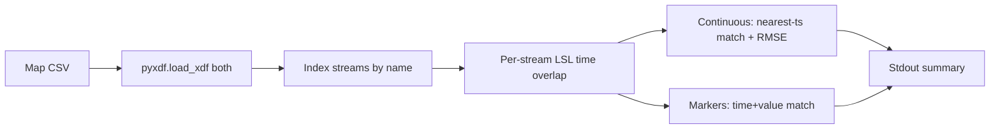

# Compare dual-recorder XDF overlap

## Context from the mapped files

The CSV [`data/PhoLogToLabStreamingLayer_and_LabRecorder_XDF_File_map.csv`](c:\Users\pho\repos\EmotivEpoc\ACTIVE_DEV\PhoLogToLabStreamingLayer\data\PhoLogToLabStreamingLayer_and_LabRecorder_XDF_File_map.csv) pairs:

- **Testing:** `20261117_083109_log.xdf` (~2 MB, ~112 s) — PhoLog in-process LabRecorder
- **Ground truth:** `LabRecorder_Apogee_..._eeg.xdf` (~98 MB, ~5494 s) — App-LabRecorder

Both were recorded on the same machine; pyxdf `time_stamps` are already in a shared LSL `local_clock` domain. Observed overlap is roughly **t ∈ [39520.8, 39621.2]** (~100 s). Shared populated streams: `Epoc X`, `Epoc X Motion`, `Epoc X eQuality`, `TextLogger`, `IOGraph_Mouse`, `WhisperLiveLogger`. Marker stamps for `TextLogger` already match to ~8 µs across files.

## Approach

Add [`scripts/compare_two_xdfs.py`](c:\Users\pho\repos\EmotivEpoc\ACTIVE_DEV\PhoLogToLabStreamingLayer\scripts\compare_two_xdfs.py) — a standalone CLI (same style as other `scripts/`), using `pyxdf` + `numpy` (already deps). Reuse `phopylslhelper.easy_time_sync.lsl_stream_timestamps_to_unix_seconds` only for human-readable wall-clock in the report, not for alignment.

### CLI

- Default: read the map CSV (first data row) for test/GT paths
- Overrides: `--test-xdf`, `--gt-xdf`, `--map-csv`
- Flags: `--streams` (subset by name), `--tol-ms` (default 1.0 for nearest match), `--plot` (optional matplotlib overlay for one continuous stream)

### Core logic

1. **Load** both files with `pyxdf.load_xdf(..., synchronize_clocks=True, handle_clock_resets=True, dejitter_timestamps=False)` (matches [`LabRecorderXDF`](c:\Users\pho\repos\EmotivEpoc\ACTIVE_DEV\PhoPyMNEHelper\src\phopymnehelper\xdf_files.py)).
2. **Inventory**: print per-file stream name/type/n/t0/t1; list common vs unique.
3. **Overlap**: for each common stream with samples in both,  
   `t_lo = max(test_t0, gt_t0)`, `t_hi = min(test_t1, gt_t1)`; skip if `t_hi <= t_lo`.
4. **Continuous streams** (`nominal_srate > 0` or numeric `time_series`):
   - Slice both to `[t_lo, t_hi]`
   - For each test sample, `searchsorted` nearest GT timestamp within `--tol-ms`
   - Metrics: matched fraction, mean/max |Δt|, per-channel RMSE / max abs error / Pearson r, exact-equal fraction (float-safe via small epsilon)
5. **Marker / irregular streams** (`srate == 0`):
   - Slice to overlap; match GT events within tolerance; report matched/unmatched and string equality of payloads
6. **Report**: global overlap window, per-stream table, exit code non-zero if any continuous stream has match rate below a fixed threshold (e.g. 0.99) or RMSE above a generous default — useful as a validation gate.

### Out of scope

- No MNE / PhoPyMNEHelper dependency
- No writing a new XDF
- No README rewrite beyond a one-line usage note only if you want it later (omit for this change)

## Implementation todos

- Parse map CSV + CLI args; resolve paths
- Load/index streams; compute LSL overlap windows
- Continuous + marker comparison metrics; print report
- Optional `--plot` for EEG (or first continuous) overlay on overlap window
