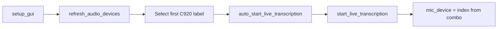

# Default Live Audio input to C920 webcam mic

The dropdown in [live_whisper_transcription.py](C:/Users/pho/repos/EmotivEpoc/ACTIVE_DEV/whisper-timestamped/whisper_timestamped/mixins/live_whisper_transcription.py) currently initializes to `"Default"`:

```98:103:C:/Users/pho/repos/EmotivEpoc/ACTIVE_DEV/whisper-timestamped/whisper_timestamped/mixins/live_whisper_transcription.py
        self.audio_device_var = tk.StringVar(value="Default")
        ...
        self.refresh_audio_devices()
```

Auto-start at 200ms in [logger_app.py](C:/Users/pho/repos/EmotivEpoc/ACTIVE_DEV/PhoLogToLabStreamingLayer/src/phologtolabstreaminglayer/logger_app.py) then reads that combo and passes `mic_device=None` into sounddevice, which is the OS default — not the highlighted `3: Microphone (HD Pro Webcam C920)`.

Index `3` is not stable (the same physical mic also appears as `12`). Match by name and take the **first** list entry containing `HD Pro Webcam C920`. That is the highlighted WASAPI entry in the screenshot. If the webcam is unplugged, keep `"Default"`.

## Change (this repo only)

Override `refresh_audio_devices` on `LoggerApp` so the lab-specific default stays out of the generic whisper mixin:

- Add a preferred-name constant, e.g. `PREFERRED_MIC_DEVICE_SUBSTRING = "HD Pro Webcam C920"`.
- Call `super().refresh_audio_devices()`, then if the current selection is `"Default"` (or missing), set `audio_device_var` to the first combo value whose label contains that substring.
- Because the mixin GUI already calls `self.refresh_audio_devices()`, the override runs at tab setup. Auto-start (`start_live_transcription`) already parses `"3: Microphone (...)"` into `mic_device=3`, so no start-path change is needed.



## Test

Add a small unit test in the same style as [tests/test_recording_auto_start_settings.py](C:/Users/pho/repos/EmotivEpoc/ACTIVE_DEV/PhoLogToLabStreamingLayer/tests/test_recording_auto_start_settings.py): fake combo values matching the screenshot (`Default`, C920 at 3, C920 at 12, Jabra, etc.) and assert the helper picks `3: Microphone (HD Pro Webcam C920)`, and falls back to `"Default"` when C920 is absent.
