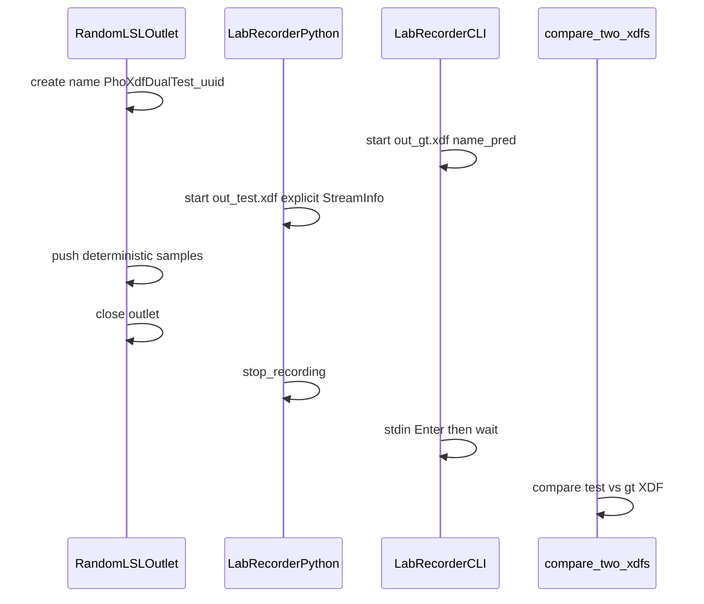

# Dual-recorder XDF self-test

## Why not only reuse the existing dual test

[`EXTERNAL/lab-recorder-python/tests/test_dual_xdf_recording.py`](c:\Users\pho\repos\EmotivEpoc\ACTIVE_DEV\PhoLogToLabStreamingLayer\EXTERNAL\lab-recorder-python\tests\test_dual_xdf_recording.py) already dual-records Python + C++ LabRecorder, but:

- Stream names are fixed (`TestTextLog`, …) — can collide with leftover test outlets
- External side uses RCS `select all` — **records every visible LSL stream**, including the user’s Epoc/etc.

This new script prioritizes isolation: one random stream name + predicate-scoped App-LabRecorder CLI.

## Approach

Add [`scripts/dual_recorder_self_test.py`](c:\Users\pho\repos\EmotivEpoc\ACTIVE_DEV\PhoLogToLabStreamingLayer\scripts\dual_recorder_self_test.py).

### 1. Isolated test stream

- Single continuous `float32` outlet (3 channels, ~20 Hz) with a deterministic ramp `[i, i+1, i+2]` so value equality is checkable.
- Name / `source_id`: `PhoXdfDualTest_{uuid4().hex[:8]}` (and matching source id) so discovery cannot confuse real streams.
- Keep the outlet alive until both recorders have started; push for a fixed duration (default ~3 s); then delete the outlet.

### 2. Writers (one of each)

| Role | Writer | How streams are scoped |
|------|--------|------------------------|
| Testing XDF | `labrecorder.LabRecorder(enable_remote_control=False)` | `find_streams` → filter **by exact name** → `start_recording(path, [info])` |
| Ground-truth XDF | `LabRecorderCLI.exe` from App-LabRecorder | Predicate `name="PhoXdfDualTest_…"` so **only** that stream is recorded |

Resolve CLI next to the same exe defaults as [`ExternalLabRecorderInstance`](c:\Users\pho\repos\EmotivEpoc\ACTIVE_DEV\PhoLogToLabStreamingLayer\EXTERNAL\lab-recorder-python\labrecorder\launch_and_control_external_cpp_labrecorder_app.py) (`LABRECORDER_EXE` / default single-build path → sibling `LabRecorderCLI.exe`), override with `--labrecorder-cli` / `LABRECORDER_CLI`.

Stop CLI by writing `\n` to stdin and `wait()` (CLI blocks on `cin.get()` after recording starts — see [`clirecorder.cpp`](c:\Users\pho\repos\EmotivEpoc\ACTIVE_DEV\App-LabRecorder\src\clirecorder.cpp)).

Start order: create outlet → short resolve wait → start **CLI** first (slower / one-shot resolve) → start **Python** LabRecorder → push → close outlet → stop Python → stop CLI.

### 3. Outputs and compare

- Write under a temp dir (or `--outdir`), filenames like `dual_test_{stamp}.xdf` / `dual_gt_{stamp}.xdf`.
- After both files finalize, invoke the compare logic already in [`scripts/compare_two_xdfs.py`](c:\Users\pho\repos\EmotivEpoc\ACTIVE_DEV\PhoLogToLabStreamingLayer\scripts\compare_two_xdfs.py) via `--test-xdf` / `--gt-xdf` (import `main` or subprocess). Exit non-zero if recording or compare fails.
- Assert the compared stream is exactly the random name (no other streams expected in either file when isolation worked).

### 4. CLI flags

- `--duration` (push length), `--outdir`, `--labrecorder-cli`, `--tol-ms` (forwarded to compare)
- No GUI LabRecorder / RCS path in this script (avoids `select all` pollution)

## Out of scope

- Changing PhoLog `LoggerApp` recording paths
- Reworking `test_dual_xdf_recording.py` (leave EXTERNAL multi-stream RCS test as-is)
- Recording markers / multiple stream types in this self-test (single continuous stream only)
