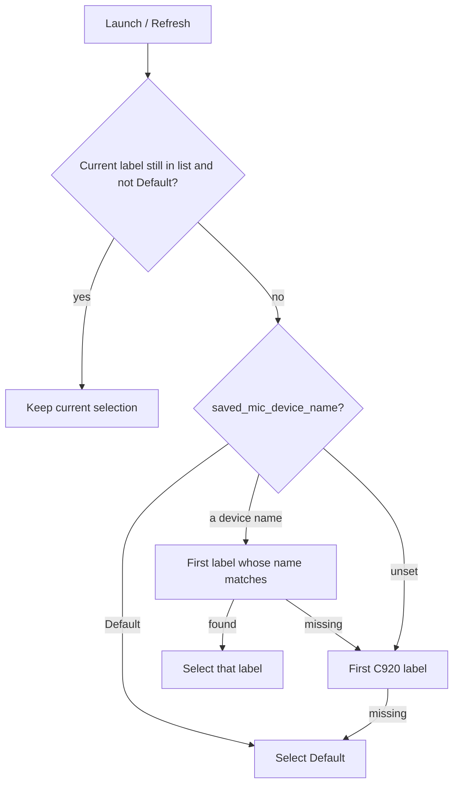

# Persist Live Audio input selection by name

Today, [refresh_audio_devices](C:/Users/pho/repos/EmotivEpoc/ACTIVE_DEV/PhoLogToLabStreamingLayer/src/phologtolabstreaminglayer/logger_app.py) always replaces `"Default"` with the first `HD Pro Webcam C920` label. A manual dropdown pick is kept only for the current process.

Save the **device name** (not PortAudio index) when the user picks from the combo, and restore that name on the next launch. Factory C920 remains the fallback only when no preference has been saved.

## Preference precedence

1. This-session combo value, if it is still in the device list and is not `"Default"`.
2. Saved name from disk (including an explicit `"Default"`).
3. Factory substring `HD Pro Webcam C920`.
4. `"Default"`.



Persist `"Default"` as a real choice (your pick): after the user selects OS Default, the next launch must **not** jump back to C920.

## Storage

New cwd file `live_audio_settings.json`, same pattern as [recording_settings.json](C:/Users/pho/repos/EmotivEpoc/ACTIVE_DEV/PhoLogToLabStreamingLayer/recording_settings.json):

```json
{ "mic_device_name": "Microphone (Jabra Evolve2 30)" }
```

- Missing file / missing key: factory C920.
- `"mic_device_name": "Default"`: OS default.
- Add `live_audio_settings.json` to [.gitignore](C:/Users/pho/repos/EmotivEpoc/ACTIVE_DEV/PhoLogToLabStreamingLayer/.gitignore) so machine-specific mics are not committed.

Store the name after `"N: "` (e.g. `Microphone (HD Pro Webcam C920)`), never the index. Reuse `preferred_audio_device_label(device_list, substring=saved_name)` to find the first matching label.

## Code changes in [logger_app.py](C:/Users/pho/repos/EmotivEpoc/ACTIVE_DEV/PhoLogToLabStreamingLayer/src/phologtolabstreaminglayer/logger_app.py)

- Add `audio_device_name_from_label()` (split on first `": "`; pass `"Default"` through).
- Load settings in `__init__` **before** `setup_gui()` so the mixin’s initial `refresh_audio_devices()` sees `self.saved_mic_device_name`.
- Rewrite `refresh_audio_devices` with the precedence above.
- After `setup_gui_LiveWhisperTranscriptionAppMixin`, bind `<<ComboboxSelected>>` (fires on user picks, not on `.set()`), and persist the name in `_on_audio_device_selected`.
- `load`/`save` helpers mirroring `_init_recording_settings` / `save_recording_settings`.

Do not persist the factory C920 unless the user actually selects it in the dropdown.

## Tests

Extend [tests/test_preferred_audio_device.py](C:/Users/pho/repos/EmotivEpoc/ACTIVE_DEV/PhoLogToLabStreamingLayer/tests/test_preferred_audio_device.py):

- No saved name + combo at `"Default"` still picks first C920.
- Saved `"Default"` stays `"Default"` even when C920 is present.
- Saved `"Microphone (Jabra Evolve2 30)"` picks `1: Microphone (Jabra Evolve2 30)` (first name match).
- Saved name absent from the list falls back to C920, then `"Default"`.
- `audio_device_name_from_label("3: Microphone (HD Pro Webcam C920)")` is the name only.
- Save/load roundtrip of `mic_device_name` via a temp file (same patch style as [tests/test_recording_auto_start_settings.py](C:/Users/pho/repos/EmotivEpoc/ACTIVE_DEV/PhoLogToLabStreamingLayer/tests/test_recording_auto_start_settings.py)).
