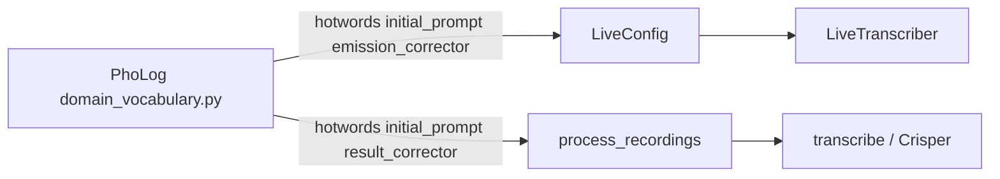

# Move domain vocabulary into PhoLog (inject into Whisper)

## Goal

Keep PhoLog-specific terms (`EEG`, `AMPH`, `1.0+`, `0.5+`, `log`) out of the public [`whisper-timestamped`](c:\Users\pho\repos\EmotivEpoc\ACTIVE_DEV\whisper-timestamped) fork. Own them in private [`PhoLogToLabStreamingLayer`](c:\Users\pho\repos\EmotivEpoc\ACTIVE_DEV\PhoLogToLabStreamingLayer) and **pass them in**.

## Design



- **whisper-timestamped**: generic plumbing only — no EEG/AMPH strings, no `domain_vocabulary` module.
- **PhoLog**: owns vocabulary + applies it at the existing `LoggerApp.setup_transcription_config()` override; offline via a thin wrapper that calls `process_recordings` with the same vocab.

## 1. PhoLog: private vocabulary module

Add [`src/phologtolabstreaminglayer/domain_vocabulary.py`](c:\Users\pho\repos\EmotivEpoc\ACTIVE_DEV\PhoLogToLabStreamingLayer\src\phologtolabstreaminglayer\domain_vocabulary.py) by moving the current sibling module contents (hotwords, initial prompt, correction regexes, `apply_*` helpers).

Move tests to [`tests/test_domain_vocabulary.py`](c:\Users\pho\repos\EmotivEpoc\ACTIVE_DEV\PhoLogToLabStreamingLayer\tests\test_domain_vocabulary.py) (correction + helper tests; drop the Crisper forwarding smoke test from PhoLog — that stays in whisper as a generic hotwords-forward test).

## 2. whisper-timestamped: strip domain defaults, keep injectable hooks

Delete [`whisper_timestamped/domain_vocabulary.py`](c:\Users\pho\repos\EmotivEpoc\ACTIVE_DEV\whisper-timestamped\whisper_timestamped\domain_vocabulary.py) and [`tests/test_domain_vocabulary.py`](c:\Users\pho\repos\EmotivEpoc\ACTIVE_DEV\whisper-timestamped\tests\test_domain_vocabulary.py) domain-content tests (keep / relocate a small `transcribe_crisper` hotwords-forward unit test under `tests/test_crisper_backend.py`).

**Live**

- [`LiveConfig`](c:\Users\pho\repos\EmotivEpoc\ACTIVE_DEV\whisper-timestamped\whisper_timestamped\live.py): keep `hotwords` / `initial_prompt`; add `emission_corrector: Optional[Callable[[dict], dict]] = None`.
- Apply corrector in `_transcriber_loop` only when set (remove hard-coded `apply_domain_corrections_to_emission` import).
- [`LiveWhisperTranscriptionAppMixin.setup_transcription_config`](c:\Users\pho\repos\EmotivEpoc\ACTIVE_DEV\whisper-timestamped\whisper_timestamped\mixins\live_whisper_transcription.py): stop importing domain vocab; leave `hotwords` / `initial_prompt` / `emission_corrector` as `None`.

**Batch / Crisper**

- [`transcribe.py`](c:\Users\pho\repos\EmotivEpoc\ACTIVE_DEV\whisper-timestamped\whisper_timestamped\transcribe.py): keep `hotwords=None` but **do not** default to any vocabulary; add optional `result_corrector`; call it only when provided. Stop importing deleted module.
- [`crisper_backend.transcribe_crisper`](c:\Users\pho\repos\EmotivEpoc\ACTIVE_DEV\whisper-timestamped\whisper_timestamped\crisper_backend.py): keep forwarding `hotwords=` (already generic).
- [`scripts/process_recordings.py`](c:\Users\pho\repos\EmotivEpoc\ACTIVE_DEV\whisper-timestamped\scripts\process_recordings.py): add optional kwargs `hotwords`, `initial_prompt`, `result_corrector` (default `None`); pass through to `whisper.transcribe` and apply corrector before `write_results` only when set. No PhoLog imports.

## 3. PhoLog: inject at live config override

In [`logger_app.py` `setup_transcription_config`](c:\Users\pho\repos\EmotivEpoc\ACTIVE_DEV\PhoLogToLabStreamingLayer\src\phologtolabstreaminglayer\logger_app.py) (~1242), after `super()`:

```python
from phologtolabstreaminglayer.domain_vocabulary import (
    apply_domain_corrections_to_emission,
    get_hotwords,
    get_initial_prompt,
)
cfg = self.transcription_config
cfg.hotwords = get_hotwords()
cfg.initial_prompt = get_initial_prompt()
cfg.emission_corrector = apply_domain_corrections_to_emission
# existing write_audio_wav=False logic stays
```

## 4. PhoLog: offline batch wrapper

Add a thin script under PhoLog (e.g. [`scripts/process_recordings_with_domain.py`](c:\Users\pho\repos\EmotivEpoc\ACTIVE_DEV\PhoLogToLabStreamingLayer\scripts\process_recordings_with_domain.py)) that imports `process_recordings` from the whisper package and always passes PhoLog `get_hotwords()`, `get_initial_prompt()`, and `apply_domain_corrections_to_result`. Reuse the same CLI args as the public script where practical (delegate / thin argparse wrapper).

## Out of scope

- Syncing/updating PhoLog’s gitignored `EXTERNAL/whisper-timestamped` copy (injection only works against a whisper build that has the new LiveConfig fields — use the sibling editable dep when testing).
- GUI prefs for editing the glossary.
