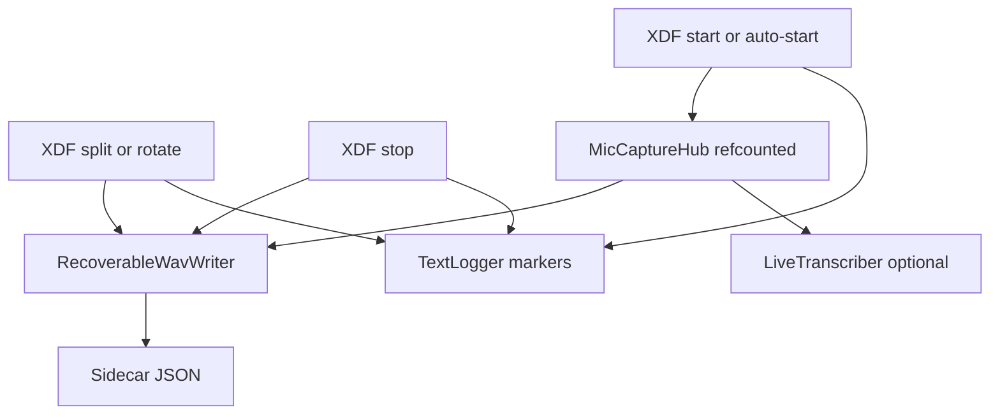

# Raw audio files that follow XDF

Today, WAV only exists as a side effect of live Whisper: [`LiveTranscriber._audio_writer`](c:\Users\pho\repos\EmotivEpoc\ACTIVE_DEV\whisper-timestamped\whisper_timestamped\live.py) writes 16 kHz PCM via `soundfile`, which **does not rewrite the RIFF header until close**, so a crash/kill leaves an unplayable file. Stopping transcription also stops capture. You chose **follow XDF**: raw audio runs whenever XDF is recording, even if Whisper is off.

## Format (crash recovery)

Use **16-bit PCM WAV** (not soundfile-on-close): immediately playable, 16 kHz matches post-hoc Whisper, and with 30 min XDF splits each file is ~57 MB (well under the 4 GB WAV cap).

[`RecoverableWavWriter`](c:\Users\pho\repos\EmotivEpoc\ACTIVE_DEV\PhoLogToLabStreamingLayer\src\phologtolabstreaminglayer\features\raw_audio.py) (new):

- Write a standard RIFF/WAVE/fmt/data header up front, then int16 LE frames from a writer thread (never from the PortAudio callback).
- Every ~1 s: `flush()` the OS buffers, seek back, patch RIFF size (`offset 4`) and data size (`offset 40`), `flush()` again. A kill loses at most about one second; the leftover file opens in any player.
- Atomic sidecar `{stem}.json` (temp file + replace) with `path`, `sample_rate`, `channels`, `fmt`, `frames_written`, `bytes_written`, `start_datetime`, `start_lsl_clock`, `stop_*`, `complete`. Sidecar is the repair key if a patch is missed.
- Clean stop: final header patch, `complete: true`.

Do **not** mux audio samples into XDF (size + worse crash behavior). Do **not** use FLAC/Ogg/MP3 (incomplete last page/frame is harder to recover than a patched WAV).

## Files and LSL sync

Folder: `{xdf_folder}/raw_audio/` (created as needed). Stem matches the XDF timestamp from [`_common_initiate_recording`](c:\Users\pho\repos\EmotivEpoc\ACTIVE_DEV\PhoLogToLabStreamingLayer\src\phologtolabstreaminglayer\logger_app.py):

- `20261030_112615_log.xdf`
- `raw_audio/20261030_112615_audio.wav`
- `raw_audio/20261030_112615_audio.json`

Markers on **TextLogger** (same path as `RECORDING_STOPPED` / `RECORDING_SPLIT_NEW_FILE`) so they land in the open XDF:

- `AUDIO_FILE_STARTED: {full_path}|sr=16000|ch=1|fmt=PCM_16|lsl_start={clock}`
- `AUDIO_FILE_STOPPED: {full_path}|frames={n}|duration_s={s}|lsl_stop={clock}`

`lsl_start` is `pylsl.local_clock()` at the first captured block (not “file open time”), so sample 0 of the WAV lines up with EEG/XDF. Also log the same lines in Log History.

**Split order** (in-process rotate and RCS stop+start):

1. Finalize current WAV, emit `AUDIO_FILE_STOPPED` (old XDF).
2. Rotate/start the new XDF (existing logic).
3. Open a new WAV using the new timestamp, emit `AUDIO_FILE_STARTED` (new XDF).

Hook the same three sites as recording control: [`start_recording`](c:\Users\pho\repos\EmotivEpoc\ACTIVE_DEV\PhoLogToLabStreamingLayer\src\phologtolabstreaminglayer\logger_app.py) / [`auto_start_recording`](c:\Users\pho\repos\EmotivEpoc\ACTIVE_DEV\PhoLogToLabStreamingLayer\src\phologtolabstreaminglayer\logger_app.py), [`stop_recording`](c:\Users\pho\repos\EmotivEpoc\ACTIVE_DEV\PhoLogToLabStreamingLayer\src\phologtolabstreaminglayer\logger_app.py) (before the recorder join, like `RECORDING_STOPPED`), [`_rotate_in_process_recording`](c:\Users\pho\repos\EmotivEpoc\ACTIVE_DEV\PhoLogToLabStreamingLayer\src\phologtolabstreaminglayer\logger_app.py) + [`start_new_split_recording`](c:\Users\pho\repos\EmotivEpoc\ACTIVE_DEV\PhoLogToLabStreamingLayer\src\phologtolabstreaminglayer\logger_app.py). Unexpected LabRecorder death (`_on_recorder_stopped_unexpectedly`) also finalizes the WAV.

Start/stop the writer on the **Tk main thread** (those methods already run there). Do not open PortAudio from `recording_worker`.

## Shared mic (transcription can toggle independently)

Whisper auto-starts at 200 ms; XDF often starts later. Stopping transcription must **not** close the mic if XDF audio is still running, and vice versa.

Add a refcounted [`MicCaptureHub`](c:\Users\pho\repos\EmotivEpoc\ACTIVE_DEV\whisper-timestamped\whisper_timestamped\audio_capture.py) (new): first subscriber opens `sounddevice.InputStream` (16 kHz mono float32, ~50 ms blocks, same as today); last subscriber closes it; blocks fan out to listeners. [`LiveTranscriber.start/stop`](c:\Users\pho\repos\EmotivEpoc\ACTIVE_DEV\whisper-timestamped\whisper_timestamped\live.py) subscribe/unsubscribe instead of owning the stream. `RawAudioRecorder` is another subscriber.

While XDF raw audio is enabled, set `LiveTranscriber` `write_audio_wav=False` so we do not write a second, non-crash-safe WAV next to the JSONL. JSONL + WhisperLiveLogger stay as they are.

## UI and settings

Persist `record_raw_audio: true` in [`recording_settings.json`](c:\Users\pho\repos\EmotivEpoc\ACTIVE_DEV\PhoLogToLabStreamingLayer\recording_settings.json) next to auto-start / auto-split (lifecycle is XDF-tied). Checkbox in the existing **XDF Recording** Settings group: “Record raw audio with XDF”. Toggling mid-session starts or stops only the WAV, not the XDF.

On the **Live Audio** tab, a status line under the Whisper controls: `Raw audio: 20261030_112615_audio.wav` or `Raw audio: idle (starts with XDF)`. Tray tooltip can include the wav basename while recording.

Default **on**. Uses the same mic combo already persisted in `live_audio_settings.json`.

## OpenSpec and tests

Scaffold `openspec/changes/add-raw-audio-xdf` (proposal + logging spec deltas for follow-XDF files, crash-safe WAV, TextLogger start/stop markers).

Tests (no live mic required for the writer):

- `RecoverableWavWriter`: write N frames, abandon without `close()`, reopen with `wave.open` and assert frames ≈ N and the file is valid.
- Sidecar `complete` false until close, true after.
- Settings roundtrip includes `record_raw_audio` in [`tests/test_recording_auto_start_settings.py`](c:\Users\pho\repos\EmotivEpoc\ACTIVE_DEV\PhoLogToLabStreamingLayer\tests\test_recording_auto_start_settings.py).
- LoggerApp unit tests with a mocked recorder: XDF start → audio start; stop → audio stop; rotate → stop then start with the new timestamp; checkbox off → no audio; Whisper stop while XDF recording → hub stays open.

## Out of scope

- LSL audio stream / samples inside XDF.
- 48 kHz archival (16 kHz is enough for offline Whisper; hub locks rate on first acquire).
- Changing XDF split policy; audio inherits the existing 30 min timer.
- Repairing historical unclosed Whisper `live_transcripts/*.wav` files.
