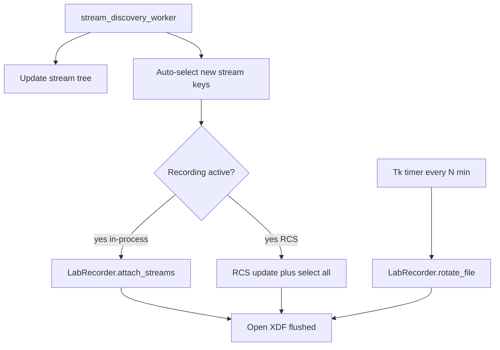

# Reliable tray XDF recording

## Why refresh feels unsafe today

Recording is a **one-shot snapshot**. Auto-start fires once, on the first discovery cycle (often only TextLogger / EventBoard / Whisper). Connecting EEG later updates the tree, but the open XDF never changes. Refresh does not talk to LabRecorder.

```1631:1634:src/phologtolabstreaminglayer/logger_app.py
                    self.lab_recorder.start_recording(
                        filename=self.xdf_filename,
                        streams=selected_stream_infos
                    )
```

lab-recorder-python already supports mid-file attach (`SimpleXDFWriter.add_stream` writes a new `StreamHeader` chunk; XDF allows this). The watch thread never attaches anything because LoggerApp passes an explicit stream list and never sets `select_all_active` / `selected_stream_uids`.

```358:367:c:\Users\pho\repos\EmotivEpoc\ACTIVE_DEV\lab-recorder-python\labrecorder\recorder.py
    def _attach_newly_selected_streams(self) -> None:
        new_streams = self.stream_manager.get_unrecorded_selected_streams(set(self.stream_inlets.keys()))
        if not new_streams:
            return
        ...
                self._setup_single_stream(uid, stream_info)
```

XDF durability is also weak: samples are not flushed (only `open()` / `close()` flush), LoggerApp joins the recorder thread for only 2s vs LabRecorder's 10s writer join, and `recording_worker` checks `self.lab_recorder.is_recording` as a method object (always truthy), so unexpected stop is never detected.

Locked policy: **hot-add new streams immediately**, and **auto-split on a timer** (default 30 min, Settings-configurable, 0 = off).



## 1. lab-recorder-python: make attach, rotate, and flush real APIs

Files: [labrecorder/recorder.py](c:\Users\pho\repos\EmotivEpoc\ACTIVE_DEV\lab-recorder-python\labrecorder\recorder.py), [labrecorder/xdf/writer.py](c:\Users\pho\repos\EmotivEpoc\ACTIVE_DEV\lab-recorder-python\labrecorder\xdf\writer.py), [labrecorder/streams/manager.py](c:\Users\pho\repos\EmotivEpoc\ACTIVE_DEV\lab-recorder-python\labrecorder\streams\manager.py)

- **Flush**: in `SimpleXDFWriter._write_chunk`, `self.file.flush()` after each chunk (cheap at EEG rates; survives process kill the same way live CSV does). Keep `close()` as-is.
- **Register streams at start**: `_resolve_selected_streams` / `start_recording` must copy the explicit `streams=` list into `stream_manager.discovered_streams` and `selected_stream_uids`, and set `select_all_active = True` so the existing watch thread can pick up later streams.
- **Public `attach_streams(stream_infos)`**: wrap `_setup_single_stream` for StreamInfo objects the GUI already resolved (LoggerApp keys by `{name}_{source_id}`, LabRecorder by `uid()`). Skip UIDs already in `stream_inlets`.
- **Public `rotate_file(new_filename)`**: keep inlets/acquisition running; drain `_data_buffers`; write footers; close writer; open a new `SimpleXDFWriter`; re-`add_stream` for every active inlet and remap `stream_ids`. This avoids the current split gap (`stop_recording` + 100ms + new worker), which would drop ~2s of EEG every interval.
- Tests in lab-recorder-python: start with markers, spawn a second outlet mid-recording, assert pyxdf sees both streams; rotate once, assert two loadable XDFs with footers and no sample-count hole larger than the writer drain.

## 2. LoggerApp: auto-add new inlets while recording

File: [src/phologtolabstreaminglayer/logger_app.py](c:\Users\pho\repos\EmotivEpoc\ACTIVE_DEV\PhoLogToLabStreamingLayer\src\phologtolabstreaminglayer\logger_app.py)

In `stream_discovery_worker` (and `refresh_streams`, which currently only replaces the dict):

- Treat newly appeared keys as selected by default (`selected_streams.add`), even after auto-start has already fired. Do **not** re-select streams the user unchecked.
- If `self.recording`:
  - In-process: `self.lab_recorder.attach_streams(new StreamInfo list)` on a worker ( `_setup_single_stream` blocks up to 1s on `pull_sample`).
  - RCS path: `update` then `select all` (C++ LabRecorder watch).
- Log to Log History + LSL: `STREAM_ADDED_TO_RECORDING: {name}`.
- Fix `is_recording` checks to call `is_recording()` so a dead recorder is actually noticed and surfaced in the UI/tray.

Manual **Refresh Streams** becomes a real “rescan and attach” instead of a tree-only redraw.

## 3. Timed auto-split as crash checkpoints

Reuse Settings persistence already in [recording_settings.json](c:\Users\pho\repos\EmotivEpoc\ACTIVE_DEV\PhoLogToLabStreamingLayer\recording_settings.json) / `_default_recording_settings`:

- `auto_add_new_streams`: true
- `auto_split_minutes`: 30 (0 disables)

While recording, a Tk `after` timer calls `rotate_file` (in-process) or stop+start (RCS fallback). Manual **Split Recording** uses the same rotate path. After rotate, update status/tray with the new `{YYYYMMDD_HHMMSS}_log.xdf` name and emit `RECORDING_SPLIT_NEW_FILE` (already exists in `start_new_split_recording`).

Increase `stop_recording` join timeout from 2s to at least 15s so footers can finish. Guard with `_split_in_progress` so timer and the button cannot overlap.

## 4. Tray as the always-on shell

- **Window X hides to tray** (`minimize_to_tray`); only tray **Exit** / `quit_app` calls `on_closing`. Today X fully quits ([console.py](c:\Users\pho\repos\EmotivEpoc\ACTIVE_DEV\PhoLogToLabStreamingLayer\src\phologtolabstreaminglayer\console.py) `WM_DELETE_WINDOW` → `on_closing`).
- Keep **Minimize to Tray** button; tray menu stays Show / Quick Log / Exit.
- Update pystray tooltip while recording: filename, selected stream count, next split time. On attach or unexpected recorder stop, log it (tray title + Log History).
- SIGINT/SIGTERM in `SingletonInstanceMixin` should run the same `on_closing` path so Ctrl+C still writes XDF footers.

## 5. Settings UI and OpenSpec

Extend the existing **XDF Recording** Settings group (`setup_recording_settings_gui`): checkboxes for auto-start (already there) and auto-add new streams, plus a split-interval spinbox. Persist via the existing load/save helpers; extend [tests/test_recording_auto_start_settings.py](c:\Users\pho\repos\EmotivEpoc\ACTIVE_DEV\PhoLogToLabStreamingLayer\tests\test_recording_auto_start_settings.py).

Scaffold OpenSpec change `add-reliable-tray-xdf` (proposal + logging spec deltas for hot-add, timed split, close-to-tray) to match prior Settings work.

## 6. Tests (no live EEG required)

- LoggerApp unit tests: new discovery keys are auto-selected; already-deselected keys stay off; `attach_streams` / RCS commands invoked only while `recording`.
- Settings roundtrip includes the new keys.
- lab-recorder: flush-after-kill simulation (write samples, `os._exit` analogue via closing the handle without `close()`, reopen leftover file — or mock file and assert `flush` called); mid-recording attach; `rotate_file` produces two pyxdf-loadable files.

## Out of scope

- Dual-writer overlap (rotate_file is enough).
- Size-based split (time is the crash bound; EEG volume is small).
- Replacing live CSV (it stays the durable notes log).
