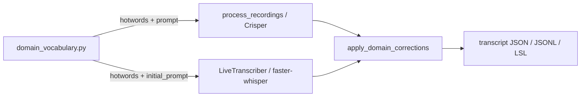

# Whisper domain phrase boosting (live + offline)

## Approach

Use a **shared vocabulary module** as the single source of truth, then:

1. Pass terms as **Crisper hotwords** (offline/GUI) and as **faster-whisper `hotwords` + `initial_prompt`** (live).
2. Apply a **small post-decode correction map** for known phonetic spellouts of the tricky tokens (`1.0+`, `0.5+`, acronyms).

Default: boosting is **on** for both pipelines (no GUI prefs in this pass).

## 1. Shared vocabulary

Add [`whisper_timestamped/domain_vocabulary.py`](c:\Users\pho\repos\EmotivEpoc\ACTIVE_DEV\whisper-timestamped\whisper_timestamped\domain_vocabulary.py):

- `DOMAIN_HOTWORDS = ["EEG", "AMPH", "1.0+", "0.5+", "log"]`
- `DOMAIN_INITIAL_PROMPT`: short English context sentence that naturally includes those terms (helps the decoder bias without fine-tuning)
- `DOMAIN_CORRECTIONS`: ordered regex/string replacements for common mishearings of the acronyms and spoken number forms (e.g. `"one point oh plus"` / `"one point zero plus"` → `1.0+`, `"zero point five plus"` → `0.5+`, plus a few EEG/AMPH variants). Keep this list small and editable.
- Helpers: `get_hotwords()`, `get_initial_prompt()`, `apply_domain_corrections(text: str) -> str` (and a segment/word-aware variant that rewrites `text` fields without breaking timestamps).

## 2. Offline / GUI batch (CrisperWhisper)

Wire hotwords through the existing stack (today they are dropped):

- [`crisper_backend.transcribe_crisper`](c:\Users\pho\repos\EmotivEpoc\ACTIVE_DEV\whisper-timestamped\whisper_timestamped\crisper_backend.py): stop swallowing `hotwords`; pass `hotwords=` into `model.model.transcribe(...)`.
- [`transcribe.py` Crisper branch](c:\Users\pho\repos\EmotivEpoc\ACTIVE_DEV\whisper-timestamped\whisper_timestamped\transcribe.py) (~280): forward `hotwords` (default from `domain_vocabulary` when not provided).
- [`scripts/process_recordings.py`](c:\Users\pho\repos\EmotivEpoc\ACTIVE_DEV\whisper-timestamped\scripts\process_recordings.py) (~613): pass `hotwords=get_hotwords()` into `whisper.transcribe(...)`.
- After transcription, run `apply_domain_corrections` on the result text/segments before `write_results`.

Note: Crisper **warns** if the loaded model is not hotword-trained v2 CT2; leave that warning in place. Hotwords still help when supported; corrections cover the rest.

## 3. Live mic (faster-whisper)

- Add `hotwords: Optional[List[str]] = None` and `initial_prompt: Optional[str] = None` to [`LiveConfig`](c:\Users\pho\repos\EmotivEpoc\ACTIVE_DEV\whisper-timestamped\whisper_timestamped\live.py).
- Defaults in [`setup_transcription_config`](c:\Users\pho\repos\EmotivEpoc\ACTIVE_DEV\whisper-timestamped\whisper_timestamped\mixins\live_whisper_transcription.py): set from `domain_vocabulary`.
- In `LiveTranscriber._transcriber_loop`, pass `initial_prompt` / `hotwords` into `model.transcribe` (extend the existing `TypeError` fallback so older faster-whisper builds still run).
- Apply `apply_domain_corrections` on emitted segment text before JSONL / LSL emit.

## 4. Tests

- Unit tests for `apply_domain_corrections` (number phrases, EEG/AMPH variants, leave unrelated text alone — especially bare `"log"` should not be aggressively rewritten).
- Smoke-style test that `transcribe_crisper` forwards `hotwords` (mock the inner model).

## Out of scope

- GUI preference UI / per-session editable glossary
- Fine-tuning or custom Whisper models
- Changing default Crisper model / runtime
